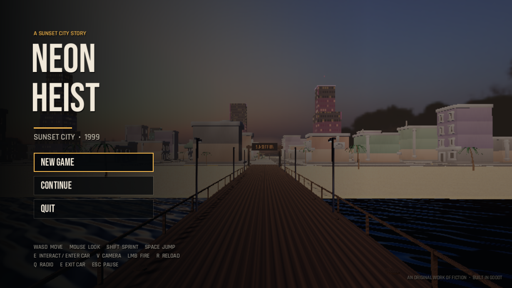
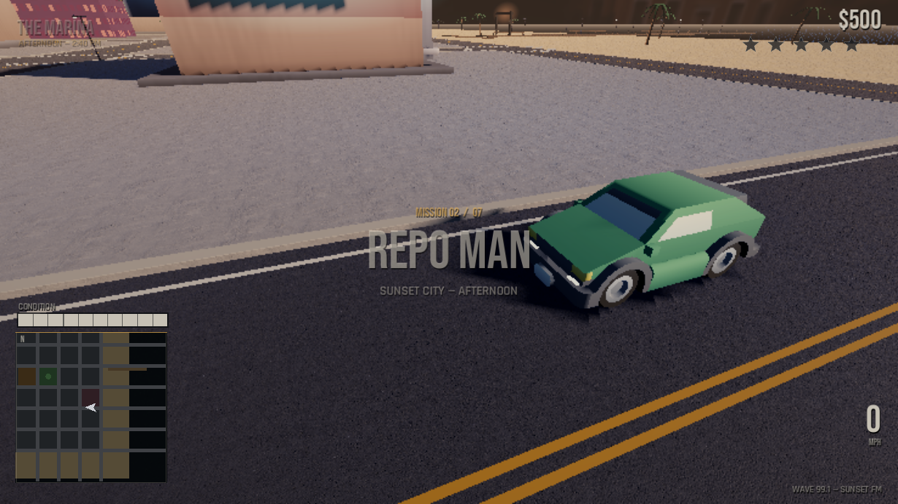

# NEON HEIST — Sunset City

A playable, story-driven open-world crime game built with **Godot 4.7**.
Sunset City, 1999. Two protagonists, seven missions, one last score.

Drive, shoot, outrun the cops and work your way from a borrowed green
hatchback to the vault of the Sunset Ledger. After the finale the city stays
open with traffic, pedestrians, police and repeatable delivery jobs.


**Status:** playable story prototype — all seven missions complete, with a
beginning, a finale and free roam afterward.

| Main menu | Driving through Sunset City |
|---|---|
|  |  |

---

## Run it

### Requirements

- **Godot 4.7.x** (standard build, not .NET) — <https://godotengine.org/download>
- Linux, Windows or macOS
- OpenGL 3.3+ / Vulkan-capable GPU
- About 40 MB of disk space for the project

No external assets, accounts or network connection are required.

### Linux

```bash
git clone https://github.com/chlkdvn/neon-heist.git
cd neon-heist
./play.sh
```

`play.sh` looks for a local Godot 4 binary (including a `Godot*` binary in the
project folder or in `~/Downloads`), then falls back to `godot4` / `godot` on
your `PATH`. You can always point it at a specific engine:

```bash
GODOT_BIN=/path/to/godot ./play.sh
```

### Windows / macOS / manual launch

```bash
godot4 --path /path/to/neon-heist --resolution 1280x720
```

Or open the project folder in the Godot editor and press **F5**.

The game targets 1280×720 and letterboxes cleanly at other 16:9 resolutions.
There is currently no pre-exported binary in the repository; it runs from the
Godot project. Export templates can be used from **Project → Export** if you
want a standalone build.

---

## Controls

| Action | Key / mouse |
|---|---|
| Move | `W A S D` or arrow keys |
| Sprint | `Shift` |
| Jump | `Space` |
| Enter / exit vehicle, interact | `E` |
| Fire pistol | Left mouse button |
| Aim | Right mouse button |
| Reload | `R` |
| Toggle first / third person (on foot) | `V` |
| Pause / resume | `Esc` |
| Change radio station | `Q` (in a car) |
| Horn | `H` (in a car) |
| Advance dialogue | `Space`, `Enter` or `E` |
| Confirm menu | `Enter` or click |

Driving is automatic when you enter a car: `W/S` throttle and brake/reverse,
`A/D` steer, `Space` handbrake, `V` changes the chase camera. The game starts in
first person on foot; `V` switches to third person.

When a mission asks you to change cars, press `E` to get out of the current car,
then `E` again at the marked car. The HUD tells you when to do this.

---

## Features

- **Seven connected story missions** across three acts, with dialogue,
  letterboxed mission cards, objective markers and escalating rewards.
- **Two protagonists** — Mara Velez and Dex — plus Cal Rourke, Nadia King and
  the Sunset Ledger.
- **Open city** with roads, raised sidewalks, curbs, lane markings, crosswalks,
  a beach, a pier, palms, street lamps and rooftop neon.
- **Arcade driving** with multiple vehicle types, AI traffic, engine audio,
  headlights, brake lights, damage and explosions.
- **On-foot action** with a first-person pistol, aiming, reloading, hitscan
  combat and third-person toggle.
- **Wanted system** with 0–5 stars, foot officers and AI police cruisers.
- **Living streets** with pedestrians and traffic on block loops.
- **HUD and minimap**, mission markers, subtitles, radio, pause menu,
  save/continue, death/respawn and a post-story free-roam delivery loop.
- **Cinematic look** — ACES tonemapping, a sunset HDRI, PBR asphalt/concrete/
  sand, directional shadows, colour grading and a subtle vignette.
- **Original audio** — synthwave radio loop, engine, siren, gunshots, impacts
  and UI sounds generated for this project.

---

## The story

Seven chained missions. Open [`STORY.md`](STORY.md) for the full story bible
and spoilers.

1. **Last Call** — meet Dex on the pier
2. **Repo Man** — steal a red sports car from the marina
3. **Debt Collection** — collect what Cal Rourke is owed
4. **The Inside Man** — work the Sunset Ledger casino
5. **Ocean Drive** — a race down the coast
6. **The Heist** — take the Ledger vault
7. **Sunset** — the last job, and the last sunset

Rewards run from **$500 to $5,000**. The story ends at the pier, but the city
stays open: traffic, pedestrians, police and delivery jobs continue.

---

## Performance

The reference machine is an **Intel i5-4210U with Intel HD 4400 graphics** at
1366×768. The game targets **30–40 FPS** there.

- 3D render scale is set to `0.6` in `project.godot`
  (`rendering/scaling_3d/scale`). Raise it to `0.75` or `1.0` on a faster GPU;
  `0.5` is the low-end fallback.
- Renderer: **GL Compatibility**, MSAA off, 1024px shadows, 7 traffic cars and
  6 pedestrians by default.
- On a laptop, thermal throttling can lower FPS during long sessions. Cap the
  frame rate or improve cooling if the benchmark drifts.

Quick benchmark from the project directory:

```bash
godot4 --path . --resolution 1280x720 res://scenes/gameshot.tscn
```

It captures screenshots to `/tmp/opencode/shots` and prints an FPS line.

---

## Project layout

```
scripts/main.gd        world boot, menu camera, grade layer, session, respawn
scripts/city.gd        procedural blocks, roads, sidewalks, pier, palms, lamps
scripts/player.gd      first/third-person controller, pistol, vehicle entry
scripts/vehicle.gd     arcade driving, AI traffic, lights, damage
scripts/humanoid.gd    pedestrians, cops, enemies, allies and combat
scripts/cops.gd        wanted-level foot patrols and cruisers
scripts/missions.gd    seven-mission director, markers, free-roam jobs
scripts/hud.gd         HUD, dialogue, mission cards, menus, minimap wiring
scripts/minimap.gd     rectangular city minimap
scripts/audio.gd       generated WAV playback, radio, engine, siren
scripts/game.gd        global state, input map, save/load
assets/                CC0 models, PBR textures, HDRI, fonts, original audio
tools/                 autoplay, screenshot, session and performance harnesses
STORY.md               story bible and mission intents
```

Save data lives in Godot's user directory:

```
~/.local/share/godot/app_userdata/NEON HEIST/neon_heist_save.json
```

---

## Assets and credits

All bundled third-party assets are **CC0** or **SIL OFL** and are suitable for
redistribution with this project.

- **Kenney** — City Kit, Car Kit, Character Pack (CC0)
  <https://kenney.nl/assets>
- **Poly Haven** — `venice_sunset_1k.hdr` sky (CC0)
  <https://polyhaven.com/a/venice_sunset>
- **ambientCG** — Asphalt 033, Concrete 034, Ground 093 A (CC0)
  <https://ambientcg.com>
- **Google Fonts** — Bebas Neue, Rajdhani (SIL OFL 1.1)
  <https://fonts.google.com>
- **Everything else** — city layout, story, characters, UI, shaders, minimap,
  mission design and all audio (music, engine, siren, gunshots, UI) were
  created for this project. Audio was synthesized by `tools/gen_audio.py`.

*All characters, names and events are original fiction. This is an independent,
stylized tribute to the open-world crime genre — not affiliated with Rockstar
Games or any existing franchise.*

---

## Development harnesses

Optional, not part of normal play:

- `tools/autoplay.gd` — smoke test that runs all seven missions, advances
  dialogue, teleports to markers and verifies story completion.
- `tools/gameshot.gd` — captures menu, pier, walk, driving and wanted-level
  screenshots, then prints an FPS benchmark.
- `tools/session_test.gd` — verifies pause, save/continue, death respawn and
  wanted-level police spawns.
- `tools/enter_test.gd` — sends real keyboard events to verify that `E`
  enters and exits a vehicle.
- `tools/perf.gd` — measures render-scale, shadow, pedestrian and traffic
  variants on a busy street.

```bash
godot4 --path . --headless res://scenes/autoplay.tscn
```

---

## Known limits

- Character and vehicle meshes are low-poly CC0 assets. First person hides the
  on-foot character; vehicle paint, lighting and the colour grade are tuned to
  make the scene read naturally.
- The game targets an integrated GPU from 2014. Photorealism and GTA6-level
  density are not feasible here; the project prioritizes a coherent, playable,
  atmospheric city at 30–40 FPS.
- Traffic follows block loops rather than a full road graph. Police cruisers
  use the same streets. Missions are hand-authored, not dynamically generated.
- This is a prototype, not a commercial release. Expect rough edges.

---

## License

The original code, story, characters and audio are © 2026 chlkdvn. The
repository is public so people can play it and follow development; please do
not republish the game or its original assets as your own. Bundled third-party
assets remain under their CC0 or SIL OFL licenses as listed above.
