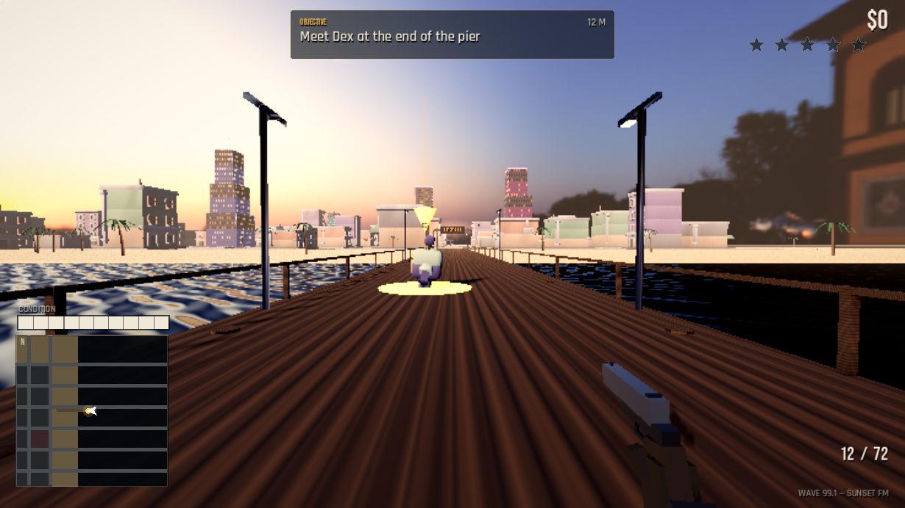

# NEON HEIST — Sunset City

A playable, story-driven open-world crime game built with **Godot 4.7.2**.
Set in the fictional coastal city of Sunset City in 1999, it follows two
protagonists — **Mara Velez** and **Dex** — through seven heist missions,
with driving, shooting, traffic, pedestrians, a wanted system and free-roam
delivery jobs after the story.



The look is **grounded stylized realism**: PBR road and concrete materials,
raised curbs, lane markings, a muted Miami-sunset palette, long shadows,
ACES tonemapping, film grain–free cinematic colour grading and a hardware-aware
render scale. It is not photoreal — the target machine is an integrated-GPU
laptop — but it is deliberately far from neon-arcade toy visuals.

---

## Run it

### Desktop launcher

Double-click **NEON HEIST** on the desktop, or run:

```bash
./play.sh
```

The launcher finds the bundled Godot 4.7.2 binary automatically. Override it
with `GODOT_BIN=/path/to/godot ./play.sh` if you move the engine.

### Direct command

```bash
"/home/divine/Downloads/Godot_v4.7.2-stable_linux.x86_64 (1)/Godot_v4.7.2-stable_linux.x86_64" \
  --path /home/divine/Documents/neon-heist --resolution 1280x720
```

Runs at 1280×720 in a window. The game is designed for 16:9; it letterboxes
cleanly at other aspect ratios.

---

## Controls

| Action | Key / mouse |
|---|---|
| Move | `W A S D` or arrow keys |
| Sprint | `Shift` |
| Jump | `Space` |
| Enter / exit vehicle, interact | `E` |
| Fire pistol | Left mouse button |
| Aim | Right mouse button |
| Reload | `R` |
| Toggle first / third person (on foot) | `V` |
| Pause / resume | `Esc` |
| Change radio station | `Q` (in a car) |
| Horn | `H` (in a car) |
| Advance dialogue | `Space`, `Enter` or `E` |
| Confirm menu | `Enter` or click |

Driving is automatic when you enter a car: `W/S` throttle and brake/reverse,
`A/D` steer, `Space` handbrake, `V` changes the chase camera. On foot the game
starts in first person; `V` switches to third person.

---

## The story

Seven chained missions across three acts. Open `STORY.md` for the full story
bible (spoilers).

1. **Last Call** — meet Dex on the pier
2. **Repo Man** — steal a red sports car from the marina
3. **Debt Collection** — collect what Cal Rourke is owed
4. **The Inside Man** — work the Sunset Ledger casino
5. **Ocean Drive** — a chase down the coast
6. **The Heist** — take the Ledger vault
7. **Sunset** — the last job, and the last sunset

Rewards run from **$500 to $5,000**. After the finale the city stays open with
repeatable delivery jobs, traffic, pedestrians and police.

---

## Performance

The reference machine is an **Intel i5-4210U with Intel HD 4400 graphics**,
1366×768. The game targets **30–40 FPS** there.

- 3D render scale is set to `0.6` in `project.godot`
  (`rendering/scaling_3d/scale`). Set it to `0.75` or `1.0` on a faster GPU
  for a sharper image; `0.5` is the low-end fallback.
- Renderer: **GL Compatibility**, MSAA off, 1024px shadows, 7 traffic cars and
  6 pedestrians by default.
- If you see thermal throttling on a laptop, cap the frame rate or raise the
  laptop's cooling. Benchmark numbers drift downward during long runs on the
  HD 4400.

Quick FPS check from the project directory:

```bash
"<godot>" --path . --resolution 1280x720 res://scenes/gameshot.tscn
```

It writes screenshots to `/tmp/opencode/shots` and prints a benchmark line.

---

## Project layout

```
scripts/main.gd        world boot, menu camera, grade layer, session, respawn
scripts/city.gd        procedural blocks, roads, sidewalks, pier, palms, lamps
scripts/player.gd      first/third-person controller, pistol, vehicle entry
scripts/vehicle.gd     arcade driving, AI traffic, lights, damage
scripts/humanoid.gd    pedestrians, cops, enemies, allies and combat
scripts/cops.gd        wanted-level foot patrols and cruisers
scripts/missions.gd    seven-mission director, markers, free-roam jobs
scripts/hud.gd         HUD, dialogue, mission cards, menus, minimap wiring
scripts/minimap.gd     rectangular city minimap
scripts/audio.gd       generated WAV playback, radio, engine, siren
scripts/game.gd        global state, input map, save/load
assets/                CC0 models, PBR textures, HDRI, fonts, original audio
tools/                 autoplay/gameshot/perf harnesses, audio generator
STORY.md               story bible and mission intents
```

Save data lives in Godot's user directory:

```
~/.local/share/godot/app_userdata/NEON HEIST/neon_heist_save.json
```

---

## Assets and credits

All bundled third-party assets are **CC0** or **SIL OFL** and are suitable for
redistribution with this project.

- **Kenney** — City Kit, Car Kit, Character Pack (CC0)
  <https://kenney.nl/assets>
- **Poly Haven** — `venice_sunset_1k.hdr` sky (CC0)
  <https://polyhaven.com/a/venice_sunset>
- **ambientCG** — Asphalt 033, Concrete 034, Ground 093 A (CC0)
  <https://ambientcg.com>
- **Google Fonts** — Bebas Neue, Rajdhani (SIL OFL 1.1)
  <https://fonts.google.com>
- **Everything else** — city layout, story, characters, UI, shaders, minimap,
  mission design, and all audio (music, engine, siren, gunshots, UI) were
  created for this project. Audio was synthesized by `tools/gen_audio.py`.

*All characters, names and events are original fiction. This is an independent,
stylized tribute to the open-world crime genre — not affiliated with Rockstar
Games or any existing franchise.*

---

## Development harnesses

These are optional and not part of normal play:

- `tools/autoplay.gd` — headless/visible smoke test that walks all seven
  missions, advances dialogue, teleports to markers and verifies completion.
- `tools/gameshot.gd` — captures menu, pier, walk, driving and wanted-level
  screenshots, then prints an FPS benchmark.
- `tools/session_test.gd` — verifies the pause menu, save/continue, death
  respawn and wanted-level police spawns.
- `tools/enter_test.gd` — sends real keyboard events to verify that `E`
  enters and exits a vehicle.
- `tools/perf.gd` — measures render-scale, shadow, pedestrian and traffic
  variants on a busy street.

```bash
"<godot>" --path . --headless res://scenes/autoplay.tscn
```

---

## Known limits

- Character and vehicle meshes are low-poly CC0 assets; first person hides the
  on-foot character, and vehicle paint/lighting are tuned to read naturally.
- True photorealism and GTA6-level density are not achievable on an Intel HD
  4400. This project prioritizes a coherent, playable, atmospheric city.
- Traffic follows block loops rather than a full road graph; police cruisers
  use the same streets. Missions are hand-authored, not dynamically generated.
